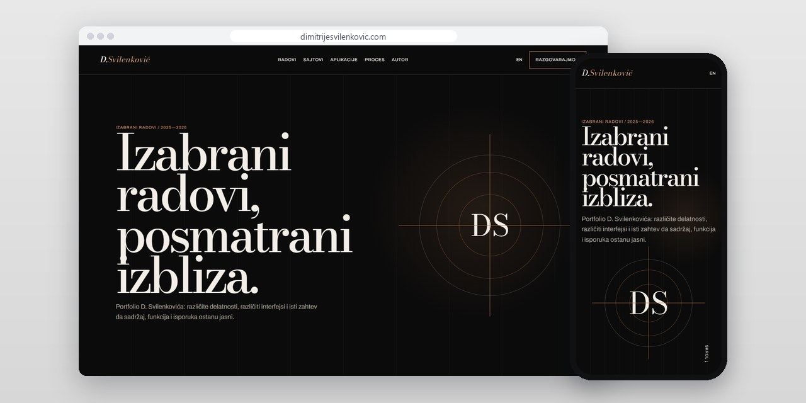
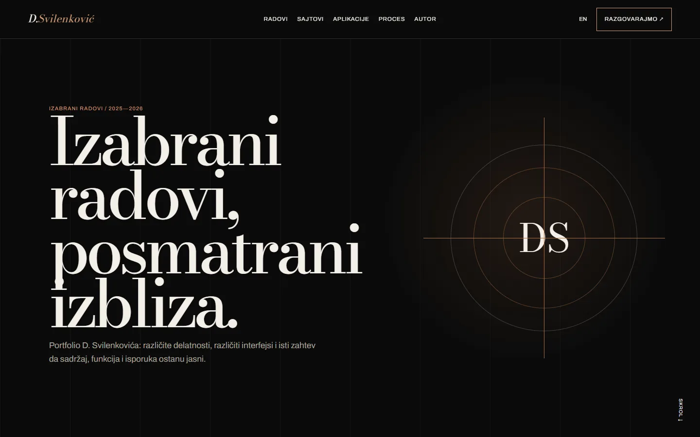
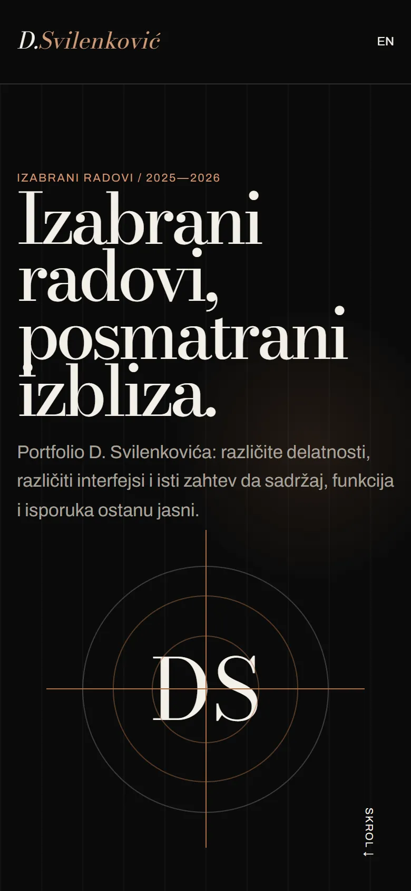
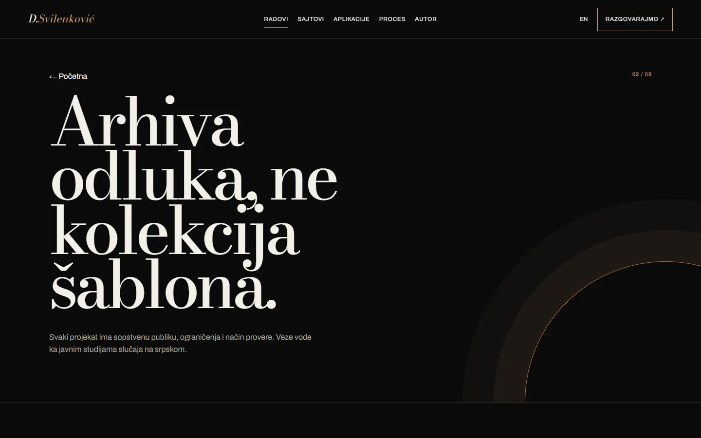

# D. Svilenković Portfolio

A personal portfolio that opens selected work as an archive of decisions: the problem, how it was shown and what can honestly be claimed.

**[dimitrijesvilenkovic.com](https://dimitrijesvilenkovic.com/)** · [Case study (in Serbian)](https://svilenkovic.rs/radovi/dimitrije-svilenkovic) · [Srpski](README.sr.md)

> [!NOTE]
> My own project, not client work. The source code is private. This page describes what the site does and how it is built.

<table>
  <tr><td><b>Client</b></td><td>Own project</td></tr>
  <tr><td><b>Industry</b></td><td>Personal portfolio</td></tr>
  <tr><td><b>Location</b></td><td>Serbia</td></tr>
  <tr><td><b>Type</b></td><td>Portfolio website</td></tr>
  <tr><td><b>My role</b></td><td>Research, design, development, SEO and hosting</td></tr>
  <tr><td><b>Stack</b></td><td>Astro 7, TypeScript, PHP 8.3, SQLite, nginx</td></tr>
</table>

## About the project

A portfolio can be a row of nice pictures, but that hides what was actually hard in a job. On dimitrijesvilenkovic.com selected projects open as an archive of decisions. Websites and applications have separate pages, and every project leads on to its live site and its public case study.

The home page is an optical archive: it starts in monochrome, and a copper lens moving over the project grid brings back the colour. On touch screens the lens turns into a scan, and every title and link stays reachable by keyboard and without the animation. There is no invented team, no awards and no made-up results.

## What I built

- Selected projects linked to their live sites and public case studies
- Separate pages for websites, applications, process and author
- An optical lens over the project grid, with a scan on touch screens
- A case study of product variants at Hemax Pro Wash
- Serbian and English versions of every page

## Results

| | Performance | Accessibility | Best practices | SEO |
| :-- | :-: | :-: | :-: | :-: |
| Mobile | 100 | 100 | 100 | 100 |
| Desktop | 100 | 100 | 100 | 100 |

PageSpeed Insights, lab test of the live site, October 2026. Security headers: 6 of 6. Structured data: `Person`.

## Screenshots

<table>
  <tr>
    <td width="68%" valign="top"></td>
    <td width="32%" valign="top"></td>
  </tr>
</table>

Selected work on the live site

---

Built by [D. Svilenković](https://svilenkovic.com).
